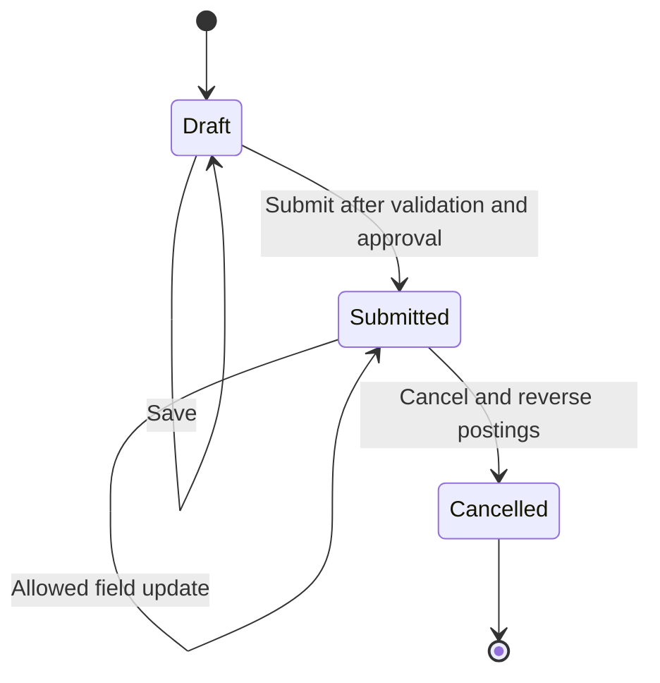
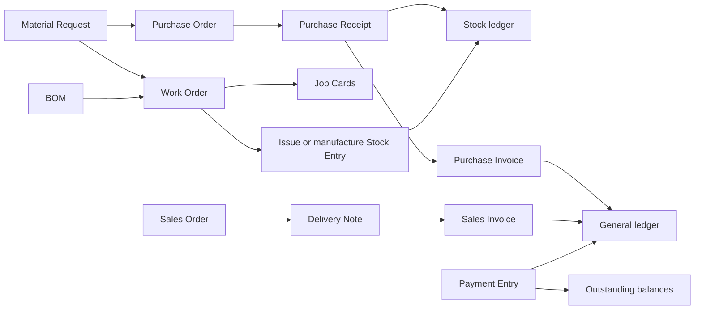

# Workflows and approvals

Static discovery identified 10 workflow-related schemas and zero shipped Workflow configuration records. Site-specific active workflow records remain unknown. Manually reading Frappe's transition engine confirmed that it checks document read access, resolves the active workflow and current state, filters by allowed role and condition, then rejects disallowed self-approval before applying state updates or task logic. The workflow layer may trigger document lifecycle actions. A separate ERPNext Authorization Control validates approving authority on applicable transactions such as Purchase Receipt and Sales Invoice. [Workflow metadata](../metadata/workflows.json) · [Transitions](../reference/frappe/frappe/model/workflow.py#L75) · [Approval source](../reference/erpnext/erpnext/setup/doctype/authorization_control/authorization_control.py#L164)

Draft, Submitted and Cancelled map to lifecycle values 0, 1 and 2. An amendment creates a new draft linked to the original. Domain states such as outstanding, on hold, closed, partially fulfilled or paid derive from document and linked transaction rules. Store domain state independently from lifecycle and workflow state. Restrict named transitions by role, row scope, expected version, condition and segregation of duties. Update state and audit on the same transaction, and route external work through an outbox after commit.

The diagram shows common dependency paths. Receipt, delivery and invoice ordering depends on transaction options and policy. Verify return, skip-step and cancellation variants before implementing. Other integration cases include Quality Inspection gates, subcontractor stock and inputs, project cost rollups and asset accounting. The Phase 6 implementation should test all transition guards, link scope and downstream compensations with deterministic fixture data.
