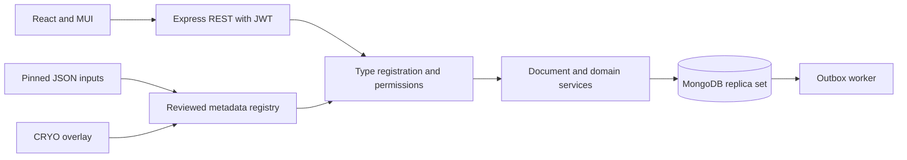

# Target MERN architecture

The Phase 2 foundation is a modular Express API and Vite app backed by a single MongoDB deployment. Keep business modules in one server and use a transactional outbox for jobs. This gives the 500-registered-user deployment a small operational footprint. Benchmark actual concurrent traffic and long-running reports before scaling.

```text
CRYO-ERP/
  AGENTS.md
  project.md
  reference/{erpnext,frappe}/
  scripts/
  metadata/
  docs/
  client/src/
    assets/  components/  engine/  layouts/  modules/  pages/
    hooks/  context/  routes/  services/  styles/  utils/
  server/
    config/  controllers/  models/  routes/  services/
    engine/  modules/  workflows/  middlewares/  validators/  utils/  tests/
```

Create folders when the first implementation needs them. Keep extraction artifacts tied to upstream commits. Build an effective versioned registry from reviewed upstream inputs, explicit allowlists and a separate CRYO overlay. Entries include canonical ID, source, field definitions, permissions, available actions, feature status and model or service adapter. Client registry responses include only the metadata required and permitted for the caller.



Controllers parse typed requests and delegate. The metadata registry compiles approved descriptors. Document services implement validated CRUD, optimistic versions, naming sequences, lifecycle and workflow. Specialized modules implement order mapping, stock and reservations, manufacturing, accounting and reconciliation. Attachments, timeline, notifications and reporting are shared services with scoped access. Begin with a separately enabled registry for read-only definitions and a reviewed allowlist of editable master types. A transactional DocType remains unavailable until its domain service is verified.

Use environment-specific configuration for JWT, MongoDB and allowed origins, and Docker where it makes local and deployment paths repeatable. Provide health and readiness endpoints, MongoDB replica-set validation, controlled migrations, connection pooling and request IDs. Configure backups and test restore, keep auditing and job retries observable, and index the list and posting paths. Use explicit client/server build scripts and pin approved dependency versions during implementation. [Database plan](04-DOCTYPES-AND-DATABASE.md) · [API contract](07-API-MAPPING.md) · [Conversion plan](12-CONVERSION-PLAN.md)
